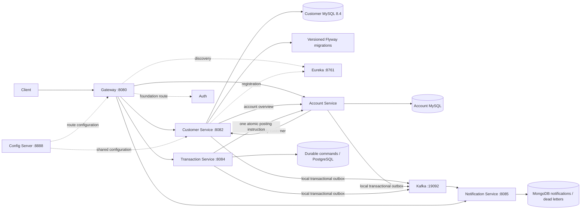

# Banking microservices — Phase 5

Java 17, Spring Boot 3.5.16, Spring Cloud 2025.0.3 and checksum-pinned Gradle 8.14.3.
The foundation, Customer, Account and Transaction services are implemented. Phase 4 adds durable monetary requests, atomic balanced postings, idempotency, concurrency control and recovery. Phase 5 adds transactional outboxes, versioned Kafka events, MongoDB notifications, consumer deduplication, retries and retained dead letters with explicit replay. Authentication remains a scaffold; JWT enforcement is Phase 6.

Architecture and mentoring: [Phase 1](docs/phase-1.md), [Phase 2 Customer Service](docs/phase-2.md), [Phase 3 Account Service](docs/phase-3.md), [Phase 4 Transaction Service](docs/phase-4.md), [Phase 5 Kafka and Notification Service](docs/phase-5.md). Historical foundation results: [Phase 1 verification](docs/verification.md).



## Prerequisites

* JDK 17, Python 3, Docker Engine and Compose v2.
* Tests require Docker: Testcontainers starts disposable MySQL 8.4, PostgreSQL 17, Kafka 3.9.1 and MongoDB 8.0 containers. No `.env` or application database credentials are needed for tests.
* Local application infrastructure uses random credentials in ignored `.env`. Generate once; never commit it.
* Maven Central, Gradle distributions/plugin repositories, Docker Hub and Quay must be reachable.
* Work from the existing repository root. Cloud tasks are already isolated; do not create a Git worktree unless explicitly requested.

In this Codex cloud machine, initialize shells with:

```bash
cd /workspace/banking-app-dra
source scripts/cloud-environment.sh
```

This activates the retained Java 17 toolchain, writable Gradle/Docker configuration and the platform HTTPS proxy with the system CA trust store. TLS verification remains enabled. Other developers should use their own JDK 17 and Docker installation.

## Build and test

```bash
./gradlew --no-daemon build
# Only Customer Service, including real MySQL REST integration tests:
./gradlew --no-daemon :customer-service:test
```

The Phase 5 build passed 95 tests with zero failures, errors or skips; see [executed verification](docs/phase-5-verification.md). Historical Phase 4 results remain in [its verification](docs/phase-4-verification.md).

Test reports: each module's `build/reports/tests/test/index.html`. Integration tests execute the real Flyway migration and Hibernate schema validation; they do not substitute H2 or silently skip when Docker is unavailable. Databases created by Testcontainers are disposable and unrelated to Compose data volumes. CI runs the same build using Java 17 and Docker on Ubuntu.

## Start the Phase 5 event development stack

```bash
./gradlew --no-daemon build
# Generate .env once only if absent: python3 scripts/create-local-env.py
docker compose config --quiet
docker compose build customer-service account-service transaction-service notification-service
docker compose up -d --wait --wait-timeout 300 api-gateway transaction-service notification-service
docker compose restart api-gateway
python3 scripts/events-smoke-test.py
npx --yes newman@6.2.1 run postman/events.postman_collection.json --delay-request 200
```

This twelve-container target runs seven applications, four databases and Kafka. Business writes capture an event in their own database transaction; background relays publish without making Kafka availability a condition of accepting business writes. Notification Service stores each event ID once, commits offsets after durable storage, and quarantines invalid or exhausted events. Read `/api/notifications`; inspect `/api/notifications/dead-letters`; explicitly replay a retained record with POST `/api/notifications/dead-letters/{id}/replay`. Notification Swagger runs directly on port 8085. See [Phase 5](docs/phase-5.md) for contracts, partitioning, consumer groups and replay rules.

For development-only outage verification, `python3 scripts/events-recovery-test.py` stops and restores this project's Kafka, Notification and MongoDB containers, retaining volumes. It checks broker recovery, duplicate delivery, consumer restart, malformed events and MongoDB outage replay. Synthetic records remain available for inspection.

## Start the Phase 4 monetary development stack

```bash
./gradlew --no-daemon build
# Generate .env once only if absent: python3 scripts/create-local-env.py
docker compose config --quiet
docker compose build account-service transaction-service
docker compose up -d --wait --wait-timeout 300 api-gateway transaction-service
# Restart an existing gateway after upgrading its route configuration:
docker compose restart api-gateway
python3 scripts/transaction-smoke-test.py
```

This nine-container target adds Transaction Service and its PostgreSQL database to the Customer/Account stack. Valid monetary requests require an `Idempotency-Key`, return 202 PENDING and are processed durably; poll the returned transaction ID until COMPLETED or REJECTED. Both transfer balances, two journal lines and the posting receipt commit atomically inside Account MySQL. The worker retries unconfirmed operations with the same ID, preventing duplicate money movement after a lost response. See [Phase 4](docs/phase-4.md) for examples, rules, recovery and architectural boundaries, and [verification](docs/phase-4-verification.md) for executed checks. Transaction OpenAPI/Swagger run directly on 8084.

The monetary smoke creates synthetic development accounts, exercises deposits/withdrawals/transfers and concurrent duplicate requests, checks reconciliation, drains its funds and leaves closed accounts with an inactive customer. Run only against development data. Optional Postman runner after gateway readiness:

```bash
npx --yes newman@6.2.1 run postman/transactions.postman_collection.json --delay-request 200
```

## Start the Customer and Account development stack

```bash
./gradlew --no-daemon build
docker compose build customer-service account-service
docker compose up -d --wait --wait-timeout 300 api-gateway account-service
python3 scripts/account-smoke-test.py
```

Generate `.env` once before first startup if it does not exist. This starts seven containers with separate Customer/Account MySQL databases. Customer creation is required before account creation; see [Phase 3](docs/phase-3.md) for API examples, validation, status rules, currency handling and limitations. Account Swagger/OpenAPI run directly on port 8083. The smoke test retains closed synthetic accounts and an inactive customer. Account numbers are internal references, not IBANs, and new accounts start with zero balances. Monetary operations are available with the Phase 4 stack.

## Start the Customer-only development stack

For Phase 2, these commands start only discovery, configuration, gateway, Customer Service and Customer MySQL:

```bash
./gradlew --no-daemon build
docker compose build customer-service
docker compose up -d --wait --wait-timeout 300 api-gateway customer-service
python3 scripts/customer-smoke-test.py
```

Generate `.env` once before first startup if needed. This five-container workflow was verified, including restart persistence. It is a smaller customer-only workflow and leaves substantially more disk space than the complete foundation stack. Other scaffold routes have no running destination in this smaller workflow; use the full stack or host-Java workflow for the all-service foundation smoke test.

## Start the full Compose stack

```bash
python3 scripts/create-local-env.py  # once; refuses to overwrite an existing .env
./gradlew --no-daemon build
docker compose config --quiet
docker compose --parallel 1 build
docker compose --parallel 1 up -d --wait --wait-timeout 300
python3 scripts/smoke-test.py
python3 scripts/customer-smoke-test.py
docker compose ps
```

Reuse prepared images when sources are unchanged. After a Customer Service change, rebuild just that service with `docker compose build customer-service`, then `docker compose up -d --wait customer-service`. Restart the gateway after route configuration changes; this phase does not support automatic configuration refresh.

The foundation smoke test checks eight application health endpoints, centralized configuration, seven Eureka registrations and five routes. The customer smoke test creates a uniquely named customer through the gateway, exercises CRUD, validation, duplicate email, pagination and logical deactivation, and leaves one inactive test record for inspection. It is a real write workflow: run only against development data.

```bash
docker compose logs --tail=100 customer-service api-gateway
docker compose down  # stop and remove containers, retain database volumes
# Destructive reset only when you explicitly want to erase local data:
# docker compose down --volumes
```

Compose provisions separate Customer/Account MySQL, Transaction/Auth PostgreSQL and Notification MongoDB stores plus Kafka and Keycloak. Customer, Account and Transaction services use their own databases. MySQL ports are published on loopback 3307/3308 and Transaction PostgreSQL on loopback 5433 for host development; MongoDB is on loopback 27018 and Kafka advertises its host listener on loopback 19092; other database ports remain internal. Web ports bind to loopback. Application containers run as a non-root numeric user with read-only jar/probe files.

## Lighter host-Java workflow

Use this Linux workflow to run applications as host processes and Customer/Account MySQL, Transaction PostgreSQL, Notification MongoDB and Kafka as containers. Do not run host and Compose applications on the same ports simultaneously.

```bash
docker compose down
# Generate .env once if it does not already exist:
# python3 scripts/create-local-env.py
./gradlew --no-daemon build
bash scripts/start-local.sh
python3 scripts/transaction-smoke-test.py
# Optional Account lifecycle regression:
python3 scripts/account-smoke-test.py
# Optional Customer lifecycle regression:
python3 scripts/customer-smoke-test.py
bash scripts/stop-local.sh
docker compose stop customer-db account-db transaction-db notification-db kafka
```

The startup script reads `CUSTOMER_DB_PASSWORD`, `ACCOUNT_DB_PASSWORD` and `TRANSACTION_DB_PASSWORD` from `.env` without executing that file as shell code, starts both MySQL stores, Transaction PostgreSQL, Notification MongoDB and Kafka, waits for readiness, then starts the eight applications and runs the foundation smoke test. Existing exported credentials take precedence. With an external database, set `CUSTOMER_DB_URL`, `CUSTOMER_DB_USER` and `CUSTOMER_DB_PASSWORD` securely; setting an explicit URL suppresses automatic local MySQL startup. Account follows the same convention with `ACCOUNT_DB_URL`, `ACCOUNT_DB_USER` and `ACCOUNT_DB_PASSWORD`. Transaction follows the same convention with `TRANSACTION_DB_URL`, `TRANSACTION_DB_USER` and `TRANSACTION_DB_PASSWORD`. Set `NOTIFICATION_MONGO_URI` or `KAFKA_BOOTSTRAP_SERVERS` to suppress startup of the corresponding local container. Logs/PIDs live in ignored `.run/`. Repeated startup reuses owned running processes; shutdown stops only those Java processes and leaves database data intact.

For debugging, stop the Customer Service process first, leave discovery/configuration/MySQL running, then:

```bash
source scripts/local-customer-env.sh
./gradlew :customer-service:bootRun --debug-jvm
```

Attach the debugger to port 5005. Defaults are Customer MySQL at `jdbc:mysql://localhost:3307/customers?connectionTimeZone=UTC`, user `customer`; a password is required. JPA validates the Flyway schema and never automatically creates/updates it. All timestamps are UTC at MySQL microsecond precision.

## Customer API

Gateway base: `http://localhost:8080/api/customers`. Direct service base: `http://localhost:8082/customers`.

| Method | Gateway path | Behavior |
|---|---|---|
| POST | `/api/customers` | Create active customer; 201 with Location header |
| GET | `/api/customers/{id}` | Get active or inactive customer; 404 when missing |
| GET | `/api/customers?page=0&size=20&status=ACTIVE` | Stable ID-order pagination; status optional |
| PUT | `/api/customers/{id}` | Replace information, preserve status and creation time |
| DELETE | `/api/customers/{id}` | Logical deactivation; 204, including repeated calls |

```bash
curl -i -X POST http://localhost:8080/api/customers \
  -H 'Content-Type: application/json' \
  -d '{"firstName":"Dragan","lastName":"Pajic","email":"customer@example.com","phone":"+38761123456"}'
curl -fsS http://localhost:8080/api/customers/1
curl -fsS 'http://localhost:8080/api/customers?page=0&size=20'
curl -i -X PUT http://localhost:8080/api/customers/1 \
  -H 'Content-Type: application/json' \
  -d '{"firstName":"Updated","lastName":"Pajic","email":"customer@example.com","phone":"+38762123456"}'
curl -i -X DELETE http://localhost:8080/api/customers/1
```

Use the ID returned by POST rather than assuming ID 1. Names/email/phone are trimmed; emails are stored lowercase and uniquely constrained. Names are required and limited to 100 characters, email to 254, and phone must use E.164 (a leading `+`, country code and 8–15 digits). Page is zero-based; size is 1–100. Status is ACTIVE or INACTIVE. Inactive customers retain their email identity, and updates cannot reactivate them.

JSON examples and error responses are in [Phase 2 docs](docs/phase-2.md). Swagger UI is at Customer Service `/swagger-ui/index.html`; OpenAPI JSON at `/v3/api-docs` on port 8082. OpenAPI is accessed directly at the service in this phase. Import `postman/customers.postman_collection.json` to run a lifecycle manually; the Create request captures `customerId`. `postman/foundation.postman_collection.json` contains infrastructure probes.

To execute the Customer Postman collection from the command line against the running gateway:

```bash
npx --yes newman@6.2.1 run postman/customers.postman_collection.json
```

Node.js/npm are needed only for this optional runner. The collection contains 10 requests and 13 assertions, and leaves one inactive development customer.

## Foundation endpoints

Services retain ports 8080 Gateway, 8081 Auth, 8082 Customer, 8083 Account, 8084 Transaction, 8085 Notification, 8888 Config and 8761 Eureka. All expose `/actuator/health`, `/actuator/health/readiness` and `/actuator/health/liveness`. Keycloak is on 8090 with a `banking` realm and ADMIN, CUSTOMER, BANK_EMPLOYEE roles; no customer users are imported. The public OIDC client uses Authorization Code + PKCE. Authentication enforcement is Phase 6.

The gateway strips only `/api` for Customer, Account and Transaction routes, preserving `/customers`, `/accounts`, `/transactions` and `/transfers`. Notification also preserves `/notifications`; Auth scaffold routes strip `/api/{service}`. `/api/customers/foundation` remains a compatible infrastructure probe. Customer account overview is available at `/api/customers/{id}/accounts` and returns a paginated response from Account Service; dependency errors return 503.

## Monitoring and limitations

Prometheus, Grafana and Zipkin are optional infrastructure under the `monitoring` Compose profile. Metrics integration, dashboards, tracing and ELK remain Phase 7. Grafana uses a generated local admin password. Kafka is a local single-broker KRaft node; Phase 5 provisions five business topics and five dead-letter topics, each with three partitions. Production replication and monitoring remain future work.

This foundation has no JWT/ownership enforcement and must use development data on local networks. Keycloak uses its development database for now. Kubernetes and deployment automation remain Phase 8. Phase 4 verifies atomic posting, balanced journals, idempotency, concurrent requests and failure recovery; real payment settlement and customer authorization are not connected.

The cloud Docker VFS driver duplicates image layers and has a 32 GB disk. The full Phase 1 stack left about 589 MB free. Prefer the twelve-container event target or the host-Java workflow for development and remove unused project containers before substantial builds or Testcontainers runs. Do not start heavy monitoring here without additional disk capacity; preserve data volumes and user-owned caches/images.

Phase 5 records notifications and supports controlled replay. External email/SMS delivery and advanced fraud detection are not implemented; security is Phase 6.

## Historical Phase 2 verification

The Phase 2 build passed with 29 Java tests: 22 Customer Service tests (17 real-MySQL API cases, four Mockito unit tests and one foundation probe test), plus seven unchanged foundation tests with reusable passing results. The affected Customer tests were rerun after the Location header correction.

The host-Java workflow passed foundation and customer lifecycle smoke tests. The five-container Customer development stack is healthy and passed its lifecycle smoke test. The Postman collection passed 10 requests and 13 assertions using Newman. Customer data/timestamps remained unchanged after restarting both MySQL and Customer Service, and Flyway retained one successful V1 migration. Swagger UI HTML and generated OpenAPI were retrieved successfully. See [detailed results](docs/phase-2-verification.md).

Phase 2 development branch: `feat/phase-2-customer-service`. Updated startup instructions were saved as a cloud configuration draft; saving a draft does not publish an environment.

## Phase 3 feature branch

Phase 3 is developed on `feat/phase-3-account-service`, based on `feat/phase-2-customer-service`. See [Phase 3 design and commands](docs/phase-3.md), [Account Postman collection](postman/accounts.postman_collection.json) and [Phase 3 verification](docs/phase-3-verification.md) for executed outcomes. Java host development needs both databases; the default Account URL is `jdbc:mysql://localhost:3308/accounts?connectionTimeZone=UTC`, user `account`, with ACCOUNT_DB_PASSWORD required. Optional external endpoints use CUSTOMER_SERVICE_URL and ACCOUNT_SERVICE_URL. Phase 3 itself introduced no balance mutation; Phase 4 now adds atomic monetary postings.

## Phase 4 feature branch

`feat/phase-4-transaction-service` is based on `feat/phase-3-account-service`. See [Phase 4 design](docs/phase-4.md), [Postman collection](postman/transactions.postman_collection.json) and [verification](docs/phase-4-verification.md). The default host Transaction URL is `jdbc:postgresql://localhost:5433/transactions`, user `transaction`, with `TRANSACTION_DB_PASSWORD` required. Gateway creation, history and search use `/api/transactions`; transfers use `/api/transfers`. Internal posting/reconciliation endpoints have no public gateway route.

## Phase 5 feature branch

`feat/phase-5-kafka-integration` is based on `feat/phase-4-transaction-service`. See [design](docs/phase-5.md), [event schema](docs/events/bank-event-v1.schema.json), [Postman collection](postman/events.postman_collection.json) and [verification](docs/phase-5-verification.md). Host development defaults to Kafka `localhost:19092` and MongoDB `localhost:27018`; external endpoints use `KAFKA_BOOTSTRAP_SERVERS` and `NOTIFICATION_MONGO_URI`.
