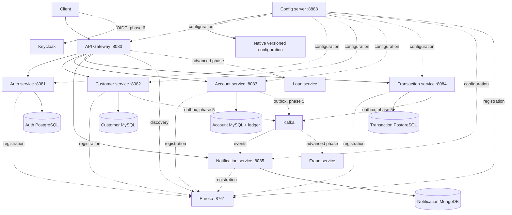

# Banking microservices — Phase 1

A Java 17 / Spring Boot 3.5.16 / Spring Cloud 2025.0.3 educational banking platform.
Gradle 8.14.3 is pinned by the wrapper. Boot 3.5 and Cloud 2025.0 are a compatible release pair; Gradle runs on Java 17.
Only **Phase 1 (foundation)** is implemented. Business probes identify services; they are not banking APIs. No balance, transaction, authentication enforcement or financial correctness is implemented yet.

## Architecture



Database and Kafka arrows describe the final design; Phase 1 does not connect business services to persistence or messaging. Fraud/loan and the optional dashboard are deferred to Phase 9. See [foundation design and mentoring](docs/phase-1.md).

## Prerequisites

* JDK 17 (`java -version`) and Python 3 for scripts.
* Docker Engine and the Compose v2 plugin for the container workflow.
* Approximately 6–8 GB available RAM for the foundation and infrastructure; monitoring needs additional resources.
* Network access to Maven Central, Gradle distributions/plugin repositories, Docker Hub and Quay. No GitHub token or external API credentials are required.

Run commands from the repository root. Linux commands below use the existing checkout; cloud tasks are already isolated and do not need a Git worktree.

## Build and test

```bash
./gradlew --no-daemon build
```

This compiles all modules, runs eight tests, and produces each service's executable `build/libs/app.jar`. Unit/MVC tests cover five probe responses; three application context tests verify real HTTP health checks for discovery, configuration and gateway. Reports live under each module's `build/reports/tests/test/index.html`.

## Start with Docker Compose

```bash
python3 scripts/create-local-env.py  # once: creates ignored, permission-restricted .env
./gradlew --no-daemon build
docker compose config --quiet
docker compose --parallel 1 build  # skip when using already-prepared images
docker compose --parallel 1 up -d --wait --wait-timeout 300
python3 scripts/smoke-test.py
docker compose ps
```

The credential generator fails rather than replacing an existing `.env`. Credentials are random local values, never committed. Compose requires them explicitly. Do not print resolved Compose configuration or share `.env`. Database ports are internal to the Compose network; web ports bind only to loopback. MySQL 8.4 is the MySQL 8 LTS line. Each domain has a separate database container and volume. Keycloak uses its development database in a persistent volume for Phase 1; production PostgreSQL integration and authentication are later work.

Expected smoke result:

```text
PASS: eight health endpoints, centralized config, seven registrations, five gateway routes
```

Infrastructure readiness is checked by Compose health checks. Smoke checks additionally verify functional configuration retrieval, Eureka registrations, and all five load-balanced routes. Discovery takes time; the script retries for up to 180 seconds and exits nonzero on failure.

```bash
docker compose logs --tail=100 api-gateway customer-service
docker compose down                # stop, retain database volumes
# Destructive reset, only when you intend to discard local data:
# docker compose down --volumes
```

## Faster Java-only development

The foundation applications do not yet require databases, Kafka or Keycloak, so they can run independently of Docker:

```bash
./gradlew --no-daemon build
bash scripts/start-local.sh
curl -fsS http://localhost:8080/api/customers/foundation
bash scripts/stop-local.sh
```

Expected response: `{"service":"customer-service","phase":"foundation"}` (JSON key order may differ). The startup script starts discovery then configuration, waits for readiness, starts the remaining applications and runs the live smoke test. Logs and PID files are ignored under `.run/`. It is safe to repeat startup for the processes it started. Do not run the local and Compose application workflows simultaneously on the same ports.

For debugging a single service, stop its existing instance and run `./gradlew :customer-service:bootRun --debug-jvm` with discovery/configuration already running; attach a debugger to port 5005. `./gradlew :customer-service:test` runs that module's tests. Stop only processes started by this project.

## Endpoints

| Component | Port | Validation |
|---|---:|---|
| Gateway | 8080 | `/api/customers/foundation` and equivalent routes below |
| Authentication scaffold | 8081 | `/foundation` |
| Customer scaffold | 8082 | `/foundation` |
| Account scaffold | 8083 | `/foundation` |
| Transaction scaffold | 8084 | `/foundation` |
| Notification scaffold | 8085 | `/foundation` |
| Config server | 8888 | `/customer-service/default` |
| Eureka | 8761 | `/eureka/apps` with `Accept: application/json` |
| Keycloak | 8090 | `/realms/banking/.well-known/openid-configuration` |

All applications expose `/actuator/health`, `/actuator/health/readiness`, and `/actuator/health/liveness`. Gateway paths are `/api/{auth,customers,accounts,transactions,notifications}/foundation`. The gateway strips the two path segments and resolves `lb://service-name` through Eureka. Unknown business paths return 404. Import `postman/foundation.postman_collection.json` to inspect foundation probes. Swagger and banking API collections arrive with the business APIs.

## Optional monitoring infrastructure

```bash
docker compose --profile monitoring up -d
```

This starts Prometheus, Grafana and Zipkin infrastructure only. Service metrics, dashboards, tracing and ELK are Phase 7; the Prometheus configuration intentionally has no scrape targets yet. Grafana uses a generated local admin password from `.env`; do not expose it publicly. Optional monitoring has not been accepted as working application observability in Phase 1.

## Scope and security

This is an intentionally local foundation. Endpoints do not yet validate JWTs, enforce ownership, or provide authenticated internal communication. Keycloak imports the `banking` realm with ADMIN, CUSTOMER and BANK_EMPLOYEE roles and a public Authorization Code + PKCE client; it creates no customer users. Do not deploy this phase publicly or use real banking data. Infrastructure credentials are generated, and passwords belong to the identity provider rather than service code.

Next: Phase 2 implements Customer Service, Flyway/MySQL persistence, validation, errors, API docs and unit/integration tests. Implementation stops after Phase 1 pending confirmation. Kubernetes, full CI/CD deployment, financial tests, Kafka consumers and security tests are later phase deliverables.

## Validated cloud instance

In this cloud machine, run `source scripts/cloud-environment.sh` before Java/Gradle/Docker commands. This selects the retained Java 17 toolchain and configures the environment HTTPS proxy and CA trust store outside the repository. TLS verification remains enabled.

All eight tests passed, all fifteen core Compose containers became healthy, and the live smoke test passed in both Java-only and Compose workflows. Installation was repeated successfully with retained build outputs. The cloud Docker VFS driver consumes substantial disk space: about 589 MB remained with the full stack running. Reuse prepared images; use the Java-only workflow or provide more disk space before substantial container rebuilds or optional monitoring. Stop/remove the Compose containers with `docker compose down` before Java-only startup; database volumes are retained.

Source files are new and uncommitted. No push, Kubernetes deployment or environment publication was performed. Reusable install/start instructions were saved in the cloud configuration draft for review and publication.
