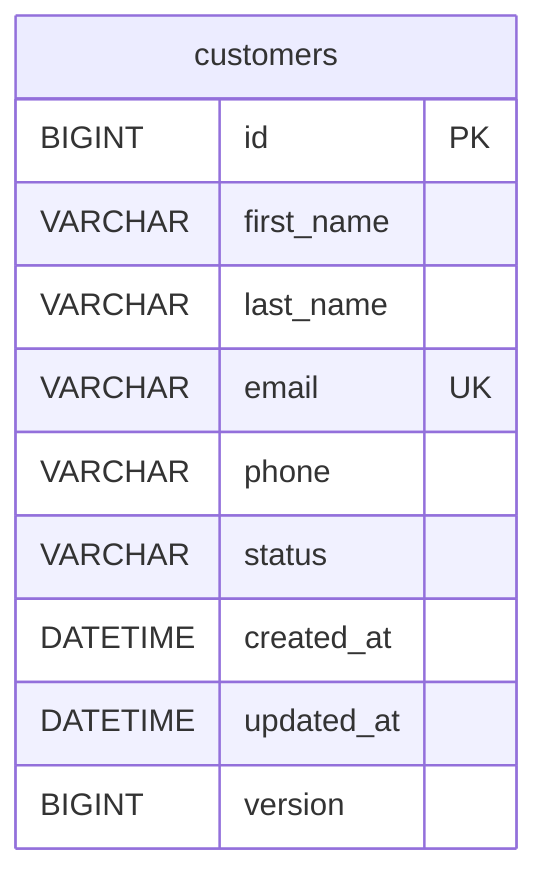

# Phase 2 — Customer Service

## Design

Customer Service owns customer identity and lifecycle in its own MySQL database. Controllers handle HTTP/validation, immutable DTO records define the API, the service owns transactional rules, and the repository owns persistence access. JPA entities remain private to this service; nothing is exported through `common-contracts`.

Create returns 201 and a relative Location header (`customers/{id}`). Resolving it against the collection request URL preserves the direct service or gateway host/prefix without relying on forwarded header trust. GET exposes inactive customers for audit/history. PUT replaces mutable information while preserving status and creation time. DELETE changes status to INACTIVE and never issues a physical deletion; repeated calls return 204. An inactive customer's email remains reserved to preserve identity. Missing records return 404 for every mutation/read rather than being recreated accidentally. Account overview is deferred to Phase 3 because Account Service has no business API yet.

Emails are normalized with `Locale.ROOT` before validation/persistence. The unique database constraint, rather than a race-prone exists-then-insert check, guarantees two requests cannot register the same normalized email. Updates flush inside their transaction, so a conflicting email fails and rolls back all changed fields. `@Version` protects overlapping database updates; it does not yet provide an HTTP ETag/If-Match contract for clients holding an old GET representation.

`@Transactional(readOnly = true)` establishes read boundaries (an optimization hint, not an authorization rule), and write methods override it. MySQL/InnoDB commits create/update/deactivate atomically within this service. `saveAndFlush`/`flush` surface constraint violations before a success response. Dirty checking persists changes to loaded entities without writing explicit UPDATE SQL. None of this is a distributed financial transaction.

A `Clock` bean makes time deterministic in unit tests. Service timestamps are UTC and truncated to microseconds to match MySQL DATETIME(6), ensuring POST and later GET representations agree. Creation time is immutable. Open-in-view is disabled; controllers receive DTOs rather than lazy entity graphs.

## Files and annotations

* `domain/Customer.java`: `@Entity`, generated `@Id`, string `@Enumerated` status, immutable creation time and optimistic `@Version`.
* `repository/CustomerRepository.java`: Spring Data `JpaRepository`, status-filtered page queries.
* `api/CustomerRequest.java`: `@NotBlank`, `@Size`, `@Email`, E.164 `@Pattern`; canonicalization in the record constructor.
* `service/CustomerService.java`: lifecycle, transactional boundaries, DTO mapping and stable ID sorting.
* `api/CustomerController.java`: `@RestController`, `@Valid` bodies, validated path/query parameters, HTTP status/Location mapping.
* `api/ApiExceptionHandler.java`: RFC 9457-style `ProblemDetail`; validation 400, missing 404, uniqueness/concurrent updates 409. SQL/database details and email values are omitted from conflict responses.
* `config/CustomerConfiguration.java`: Clock and generated OpenAPI metadata.
* `db/migration/V1__create_customers.sql`: Flyway-owned MySQL schema; Hibernate only validates it.
* Customer tests: Mockito lifecycle unit tests and full HTTP integration tests against disposable MySQL using Testcontainers.
* Compose, startup scripts and gateway config: database dependencies, loopback MySQL access and correct customer prefix handling.

## Schema



The email column uses a case/accent-sensitive MySQL 8 collation, while the application normalizes case. This keeps different internationalized characters distinct. Unique email and `(status, id)` indexes support identity and filtered pagination. Status and nonnegative version have check constraints. There are no cross-service foreign keys. Flyway applies V1 once and validates migration history on restart; do not edit an applied migration to change the schema—add a new version.

## Requests, responses and errors

POST `/api/customers` through the gateway or `/customers` directly:

```json
{"firstName":"Dragan","lastName":"Pajic","email":"customer@example.com","phone":"+38761123456"}
```

Example 201 body (ID/time generated at runtime):

```json
{"id":1,"firstName":"Dragan","lastName":"Pajic","email":"customer@example.com","phone":"+38761123456","status":"ACTIVE","createdAt":"2026-10-09T12:00:00Z","updatedAt":"2026-10-09T12:00:00Z"}
```

GET `/api/customers?page=0&size=20`:

```json
{"items":[],"page":0,"size":20,"totalElements":0,"totalPages":0}
```

Pagination uses a stable explicit contract rather than serializing Spring's internal Page implementation. Status is an optional enum filter. Offset pagination can still shift during concurrent inserts/deactivations; a cross-request snapshot/cursor contract is not provided.

Example 400 body (instance is the service request path):

```json
{"type":"about:blank","title":"Validation failed","status":400,"detail":"Correct the invalid customer fields.","instance":"/customers","errors":{"email":"must be a well-formed email address"}}
```

409 reports an existing-record conflict without SQL or personal data. 404 reports the missing customer ID. Malformed JSON, invalid enum/ID types and out-of-range pagination return 400. Authentication-related 401/403 enforcement is deferred to Phase 6.

## Verify

Run the README's build, Compose or host-Java startup commands. `scripts/customer-smoke-test.py` exercises the real gateway path, including an externally correct Location header and durable deactivation. It leaves an inactive development record; use unique emails for manual requests or expect 409. The Postman collection covers creation, retrieval, pagination, update, deactivation, inactive retrieval and invalid data.

Integration tests cover complete lifecycle, normalized duplicate email, concurrent duplicate requests, update rollback, pagination/status filtering, malformed JSON, missing records, bad parameters, Flyway migration and generated OpenAPI. The Postman collection can be executed using the Newman command in README. Unit tests cover normalization, explicit missing-customer failure, logical/idempotent deactivation and preservation of inactive status/creation time on update. Docker is mandatory for the integration suite; an unavailable Docker daemon fails rather than skipping validation.

Database access credentials are read securely from `.env` for local applications or injected through environment settings. No credentials are committed. Security and Account Service integration are not implemented in this phase.
