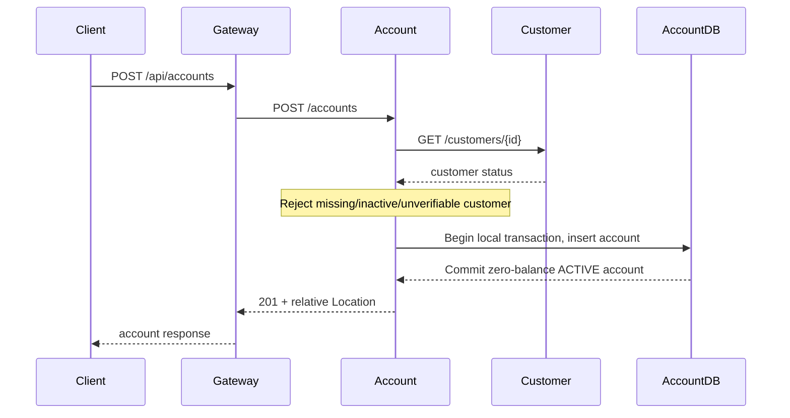
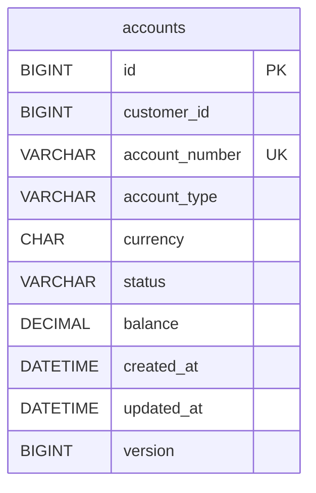

# Phase 3 — Account Service

Account Service owns accounts and their balance projection in its own MySQL 8.4 database. Customer IDs are external references with no cross-database foreign key. A real bounded REST call verifies customer identity and ACTIVE status before account creation. Customer Service now exposes a paginated account overview, obtained by REST from Account Service after its local customer lookup.



## Boundaries and consistency

`AccountService` validates currency and calls `CustomerClient` without an open database transaction. A separate `AccountRegistration` Spring bean establishes the write transaction via `@Transactional`; this avoids holding database resources while waiting for the network and avoids the self-invocation transaction-proxy trap. This separation does not make the two services atomic: a customer may be deactivated after verification and before account insertion. The check is point-in-time. Later events/reconciliation must address that lifecycle race; no automatic account blocking on customer deactivation is claimed.

Service addresses are environment-configured (`CUSTOMER_SERVICE_URL`, `ACCOUNT_SERVICE_URL`), using Compose DNS in containers and localhost in the host workflow. Gateway routes still use Eureka load balancing. Internal REST uses Java's HTTP client with a two-second connection timeout and three-second read timeout. It does not retry non-idempotent creation or disguise dependency failures as an empty list. Authentication and service identities are Phase 6; use local development data only.

No money can be deposited, withdrawn or transferred in this phase. All new balances are zero, represented using BigDecimal. Currency uses Java's ISO 4217 registry; codes are trimmed and normalized uppercase. Codes without monetary fraction digits (including XXX/metals) and unknown codes are rejected. MySQL DECIMAL(19,4) supports the supported currency scales; API values use the currency's default fraction digits, e.g. BAM 2, JPY 0, KWD 3, CLF 4. Phase 4 must constrain postings to currency precision and introduce a balanced ledger/idempotency before monetary mutations.

An account's initial status is ACTIVE. ACTIVE and BLOCKED can transition to one another or CLOSED. CLOSED is terminal; repeating the existing status succeeds without changing timestamps. Closing a nonzero balance is forbidden. This safeguard is tested with a database fixture; there is no balance mutation endpoint. `@Version` prevents overlapping stale database updates; it is not an HTTP If-Match/ETag contract. Closed account rows remain queryable and are never physically deleted.

Account numbers are random unique internal references (`BA` plus 32 uppercase hexadecimal UUID characters), **not valid IBANs**. MySQL enforces uniqueness. Creation is not idempotent: repeating a successful POST creates another account, so callers must handle ambiguous failures carefully until an explicit create-idempotency contract is added.

## Implementation and schema

* `domain`: Account entity, CURRENT/SAVINGS types, ACTIVE/BLOCKED/CLOSED statuses and domain rule failures. Domain status rules do not depend on HTTP.
* `api`: validated immutable request/response DTOs, stable pagination, REST controller and ProblemDetail error mapping.
* `client/CustomerClient`: minimal independently defined customer view, not a shared JPA entity; fail-closed verification of downstream ID/status.
* `service`: lifecycle orchestration and separate transactional registration.
* `config`: UTC Clock, bounded RestClient and OpenAPI metadata.
* `db/migration/V1__create_accounts.sql`: account table, unique number, customer-ID composite index, enum/nonnegative checks, timestamps and optimistic version.
* Customer Service additions: account page/summary DTOs, bounded overview client and controller. It verifies customer existence, including inactive customers, before querying accounts; mismatched customer references in a downstream response are rejected.



There is no relationship to a table in Customer's database. Flyway owns DDL; Hibernate validates it. Currency is explicitly mapped with `@JdbcTypeCode(Types.CHAR)` to match the fixed-width MySQL column. `@Enumerated(STRING)` avoids ordinal enum persistence. UTC microsecond timestamps match MySQL DATETIME(6). Never edit a migration already applied to persistent data; add the next version instead.

## API

Gateway paths below map to the same service paths without `/api`. The Account gateway route strips only `/api`, just like Customer Service. The legacy `/api/accounts/foundation` probe remains available.

| Method | Gateway path | Outcome |
|---|---|---|
| POST | `/api/accounts` | 201, ACTIVE zero-balance account; relative `accounts/{id}` Location |
| GET | `/api/accounts/{id}` | Account including closed accounts |
| GET | `/api/accounts/customer/{customerId}?page=0&size=20` | Stable ID-order account page; empty when no accounts exist |
| GET | `/api/accounts/{id}/balance` | `{accountId,currency,balance}` |
| PATCH | `/api/accounts/{id}/status` | Updated account; repeated status is idempotent |
| GET | `/api/customers/{id}/accounts?page=0&size=20` | Customer overview through both services |

```json
{"customerId":1,"accountType":"CURRENT","currency":"BAM"}
```

```json
{"status":"BLOCKED"}
```

After creating an active customer through the Customer API, substitute its ID:

```bash
curl -i -X POST http://localhost:8080/api/accounts \
  -H 'Content-Type: application/json' \
  -d '{"customerId":1,"accountType":"CURRENT","currency":"BAM"}'
curl http://localhost:8080/api/accounts/1/balance
curl http://localhost:8080/api/customers/1/accounts
curl -X PATCH http://localhost:8080/api/accounts/1/status \
  -H 'Content-Type: application/json' -d '{"status":"BLOCKED"}'
```

A balance response is `{"accountId":1,"currency":"BAM","balance":0.00}`. A closed-account reopen produces HTTP 409 with ProblemDetail fields including `title`, `status`, `detail` and `instance`; its detail is `Closed accounts cannot be reopened.`

Account response fields: id, customerId, accountNumber, accountType, currency, status, balance, createdAt, updatedAt. The page contract is `{items,page,size,totalElements,totalPages}`; page >= 0 and size 1–100. Account queries do not call Customer Service again, so existing account data remains readable when Customer Service is unavailable. The overview endpoint checks customer existence but does not require ACTIVE status, supporting audit/history.

Errors use application/problem+json: 400 invalid body/currency/pagination, 404 missing account or overview customer, 422 missing referenced customer during creation, 409 inactive customer/forbidden status transition/uniqueness/optimistic conflict, and 503 failed or malformed dependency responses. No SQL or credential details are returned. Roles and resource ownership are not enforced yet.

OpenAPI and Swagger UI are directly available on Account Service port 8083 at `/v3/api-docs` and `/swagger-ui/index.html`. Customer docs on 8082 include the overview endpoint. The Postman Account collection creates a synthetic customer then exercises two account types, balance, overview, status and closed-account rejection.

## Run and verify

From the repository root, activate the cloud tools when using this cloud machine, then:

```bash
source scripts/cloud-environment.sh  # cloud only
./gradlew --no-daemon build
# .env already exists here; otherwise generate once:
# python3 scripts/create-local-env.py
docker compose build customer-service account-service
docker compose up -d --wait --wait-timeout 300 api-gateway account-service
python3 scripts/account-smoke-test.py
```

This starts seven containers: discovery, configuration, gateway, Customer, Account and two independent MySQL stores. Stop project containers with `docker compose down` while retaining volumes. Host Java startup now starts both databases, reads only their individual passwords without executing `.env`, and starts all eight applications. Customer/Account MySQL loopback ports are 3307/3308. Stop the Java apps before starting Compose apps on the same ports.

```bash
./gradlew :account-service:test
# Optional Postman CLI runner against the live gateway:
npx --yes newman@6.2.1 run postman/accounts.postman_collection.json
```

Tests use disposable real MySQL and a real HTTP customer stub to exercise success, inactive/missing customer, upstream 503, invalid JSON/status and timeout. Unit tests cover ordering and no persistence on verification failure, currency scales and terminal/idempotent status rules. Overview tests verify mapping, pagination, absence handling, dependency failure and cross-customer response rejection. Live smoke validates real Customer and Account applications through the gateway. Verification results are recorded separately after checks execute.

Next is Phase 4's ledger, monetary operations, locking/idempotency and durable transaction orchestration; none are included in Phase 3.
