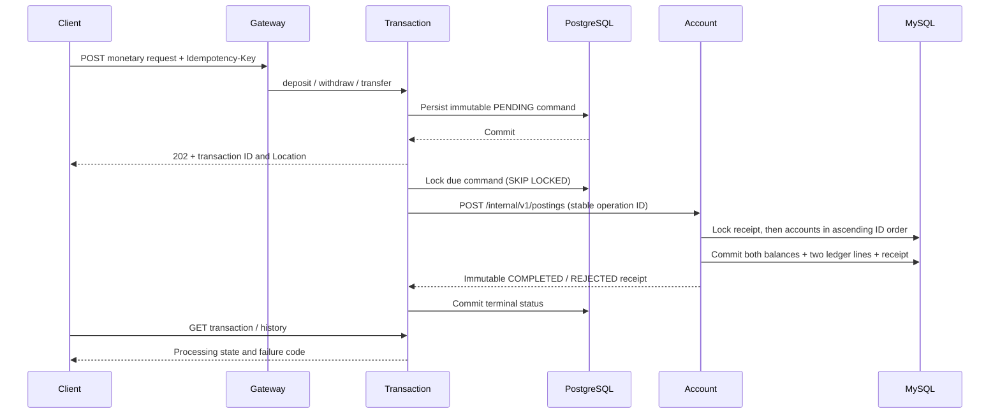

# Phase 4 — Transaction Service and atomic monetary ledger

Account Service is the authority for account status, balances, posting receipts and the monetary journal in MySQL. Transaction Service owns public requests, their idempotency keys, durable processing state and searchable history in its separate PostgreSQL database. Services share only the versioned `common-contracts` posting DTOs, never entities, repositories or database connections.



## Why a transfer does not use independent debit/credit calls

All account balances are in one Account Service database. A transfer changes its two accounts and journal entries inside **one local MySQL transaction**. There is no successful debit followed by an independently failing credit, no transfer compensation window and no distributed balance mutation. A database error after the debit rolls back both balances, both ledger lines and the deduplication receipt.

Transaction Service orchestrates one atomic instruction, not two monetary HTTP calls. Its PostgreSQL commit is not atomic with MySQL, so its status can temporarily lag a completed posting. Durable retries reconcile that gap: every retry uses the same operation UUID and instruction hash, and Account returns the original committed receipt without moving money again. This is at-least-once delivery with an idempotent receiver, not an exactly-once transport promise.

A Saga is unnecessary within this account database. If accounts are later split across databases or external banks, this design cannot simply be extended with separate debit/credit calls: that requires reservations, durable orchestration/compensation and settlement reconciliation. Cross-currency transfers are currently rejected; no exchange-rate or rounding policy is invented.

## Financial rules and journal

* Amounts use BigDecimal/DECIMAL(19,4), are positive, fit 15 integer digits and have exactly representable ISO monetary currency precision. BAM has two fraction digits, JPY zero, KWD three and CLF four. Inputs with trailing zeros are harmless; excess nonzero fractional digits are rejected without rounding.
* New account balances start at zero. Deposits and withdrawals are educational external-settlement instructions; no payment network, cash verification or real external settlement is connected.
* Both transfer accounts must exist, be different, ACTIVE and match the request currency. Withdrawals/transfers cannot overdraft. Deposits/transfers cannot exceed balance capacity. Checks occur under write locks at execution time, not at request submission.
* Every completed instruction has two signed journal lines whose sum is zero in one currency. Deposit: CLEARING `-amount`, customer `+amount`. Withdrawal: customer `-amount`, CLEARING `+amount`. Transfer: source `-amount`, target `+amount`. Positive customer entries increase the displayed balance. CLEARING represents the external counterparty and may have a negative net total; it is not a customer bank account.
* Customer balance equals the sum of that account's CUSTOMER journal entries. Transfers preserve the sum of customer balances. Deposits/withdrawals change that sum with an equal and opposite clearing movement. Currency totals are never added together.
* CLOSED is terminal; accounts with money cannot close. BLOCKED/CLOSED accounts reject all new postings. Replaying a previously committed instruction still returns its original receipt even if account status subsequently changes.
* Rejected instructions are durably recorded without journal lines or balance changes. `ACCOUNT_NOT_FOUND`, `ACCOUNT_NOT_ACTIVE`, `CURRENCY_MISMATCH`, `INSUFFICIENT_FUNDS` and `BALANCE_LIMIT` are terminal business outcomes. Adding funds later does not turn an old rejected request into a new successful debit; submit a new key deliberately.

`LedgerReconciliation` reads a repeatable MySQL snapshot and checks per-account balances against CUSTOMER entries, customer/clearing totals, and each receipt's expected two amounts, roles, account references and currency. GET `/internal/v1/ledger/reconciliation?currency=BAM` on Account port 8083 returns totals, mismatch counts and `balanced`. It reports corruption rather than changing balances or concealing discrepancies. It also checks rejected receipts have no ledger lines and no APPLYING receipt was committed.

## Concurrency, idempotency and recovery

Account receipt UUIDs are unique. An insert/unique-key lock serializes duplicate operation IDs before any account is touched. A hash of the normalized immutable monetary instruction detects ID reuse with a different payload (HTTP 409). Terminal receipts are never re-executed.

Account rows are pessimistically locked in ascending account ID order, including opposite-direction transfers. Locks remain held through status/funds checks, JPA balance changes, journal writes and receipt commit. `@Version` remains active, so a concurrent stale status change cannot overwrite a posting. The MySQL transaction uses READ COMMITTED to reduce unnecessary gap locking. Unexpected lock/database errors leave no partial posting and are retried by the durable requester.

Public `Idempotency-Key` is required: 1–100 ASCII letters, digits or `._:-`, case-sensitive. Keys are globally scoped in this educational phase; Phase 6 must bind them to authenticated principals. PostgreSQL enforces uniqueness, so simultaneous duplicate submissions create one request. Reuse with different type, accounts, normalized amount/currency or trimmed description returns 409. Formatting `100`, `100.00`, `bam` and `BAM` is equivalent; descriptions otherwise belong to the immutable request. Keys/receipts have no automatic expiry or destructive cleanup.

The worker polls every 500 ms in bounded batches. Each due PENDING row is locked using `FOR UPDATE SKIP LOCKED`, allowing other workers to claim different rows. For simplicity it retains this PostgreSQL row lock across a bounded REST call (two-second connection and three-second read timeout), then commits the status or retry schedule. No Account balance lock spans a network call. This worker design trades PostgreSQL connection occupancy for simple crash recovery; production throughput may require lease-based claims and bounded worker pools.

Unavailable services, timeouts, non-success HTTP responses, malformed JSON and mismatched receipt IDs/hashes remain PENDING with `POSTING_UNCONFIRMED`, attempt count and persisted exponential backoff (1, 2, 4, …, at most 60 seconds). They are never guessed to be business failures. The worker retries indefinitely; long-pending commands require investigation, not automatic compensation. Read/search APIs expose attempts and retry reason. Unexpected processor/database errors roll back the row transaction and are retried on subsequent cycles.

| Failure point | Durable outcome and recovery |
|---|---|
| Before public PostgreSQL commit | No accepted durable request; client retries the same key after an ambiguous response |
| After request commit, before worker runs | PENDING row survives process restart |
| Account fails before MySQL commit | No monetary changes; command retries |
| Account commits, HTTP response is lost | Original receipt exists; replay returns it without applying again |
| Account commits, PostgreSQL terminal update fails | PENDING row is replayed with the same UUID; receipt reconciles state |
| Terminal status commits | Read/history returns COMPLETED or REJECTED; duplicates return the same transaction |

## Files and Spring concepts

* `common-contracts/.../posting/v1`: immutable validated posting command/result and enums. Command canonicalization/hashing makes decimal formatting irrelevant to deduplication.
* Account `V2__posting_ledger.sql`: new receipt and journal tables with local foreign keys, primary/unique keys, signed-amount constraints and indexes. V1 is unchanged; never edit an already-applied migration.
* Account `PostingService`, repository `lockById`, entity `applyPosting`: `@Transactional` coordinates JPA and JdbcTemplate on the same MySQL connection; `@Lock(PESSIMISTIC_WRITE)` obtains account write locks. Journal/receipt writes use explicit SQL. Neither posting table is shared with another service.
* Account `LedgerReconciliation`, internal posting/reconciliation controllers: one atomic write protocol and read-only integrity diagnostics. Gateway exposes no `/internal` route. Direct loopback Account endpoints remain accessible for development; internal authentication is Phase 6, not an implemented security boundary.
* Transaction `V1__transaction_commands.sql`: PostgreSQL UUID IDs/references, unique key and request hash, immutable type/accounts/amount/currency/description, status, attempts/retry schedule and UTC timestamps. Account IDs are external references, with no cross-database foreign key.
* Transaction API DTOs/controller/advice: validated bodies/parameters, stable page contract and ProblemDetail validation/404/409 responses.
* Transaction repository uses Spring JDBC, making the queue's PostgreSQL locking SQL explicit rather than sharing JPA models. `@Transactional` on submission/processor methods establishes separate local database transactions. The scheduled `ProcessingJob` invokes a different bean so the transaction proxy is applied; no self-invocation trap.
* REST client/config: bounded Java HTTP client, validated terminal receipts, UTC Clock, OpenAPI and scheduling. Tests disable only automatic scheduling, then explicitly exercise the real transactional processor with deterministic database fixtures.
* Compose/gateway/host scripts: Transaction PostgreSQL on loopback 5433, Transaction Service 8084, `/api/transfers` routing and transaction credential helper. Existing foundation probes are retained.

## API and examples

| Method | Gateway path | Behavior |
|---|---|---|
| POST | `/api/transactions/deposit` | Deposit `{accountId,amount,currency,description?}` |
| POST | `/api/transactions/withdraw` | Withdrawal with the same shape |
| POST | `/api/transfers` | Transfer `{fromAccountId,toAccountId,amount,currency,description?}` |
| GET | `/api/transactions/{uuid}` | Durable request status/result, 404 when missing |
| GET | `/api/transactions/account/{accountId}` | Paginated history involving either side of the account |
| GET | `/api/transactions` | Paginated search across requests |

Valid POSTs persist first and return **202 PENDING** with UUID, `transactionReference`, `Location` and timestamps. A duplicate whose original is terminal returns **200** with the same UUID and outcome. Poll Location until COMPLETED or REJECTED. Terminal business rejections are returned as a 200 transaction representation with `failureCode`, not an HTTP error on GET. Amounts/account existence/status are checked by Account at execution; syntactically invalid amounts/currencies/account topology are rejected with 400 before queue insertion.

GET pages use `{items,page,size,totalElements,totalPages}`, page >= 0, size 1–100, optional `status=PENDING|COMPLETED|REJECTED` and `type=DEPOSIT|WITHDRAWAL|TRANSFER`. Ordering is newest creation then UUID, stable within a database snapshot. History includes rejections and pending commands. Description has at most 240 characters. HTTP 400 also covers a missing/invalid key, malformed body/UUID/enums and invalid pagination; 409 means key conflict. Runtime persistence failures are not falsely reported as accepted requests.

Create an ACTIVE customer and two BAM accounts first; substitute actual IDs below:

```bash
curl -i -X POST http://localhost:8080/api/transactions/deposit \
  -H 'Content-Type: application/json' -H 'Idempotency-Key: example-deposit-1' \
  -d '{"accountId":1,"amount":100.00,"currency":"BAM","description":"Development funding"}'
# Poll the returned UUID; do not treat 202 as completed money movement.
curl http://localhost:8080/api/transactions/RETURNED_UUID
curl -i -X POST http://localhost:8080/api/transfers \
  -H 'Content-Type: application/json' -H 'Idempotency-Key: example-transfer-1' \
  -d '{"fromAccountId":1,"toAccountId":2,"amount":35.00,"currency":"BAM"}'
curl 'http://localhost:8080/api/transactions/account/1?status=COMPLETED&size=20'
curl http://localhost:8080/api/accounts/1/balance
curl 'http://localhost:8083/internal/v1/ledger/reconciliation?currency=BAM'
```

Transaction Swagger `/swagger-ui/index.html` and OpenAPI `/v3/api-docs` are served directly on port 8084. Import `postman/transactions.postman_collection.json`; its polling requests wait for terminal status. Use unique keys per intended new operation, and preserve keys when retrying an ambiguous submission.

## Start, stop, test and debug

```bash
source scripts/cloud-environment.sh  # this cloud environment only
./gradlew --no-daemon build
# Generate ignored .env once only if absent:
# python3 scripts/create-local-env.py
docker compose config --quiet
docker compose build account-service transaction-service
docker compose up -d --wait --wait-timeout 300 api-gateway transaction-service
# Existing gateway needs a restart after route configuration changes:
docker compose restart api-gateway
python3 scripts/transaction-smoke-test.py
# Optional Postman runner after the smoke's gateway readiness check:
npx --yes newman@6.2.1 run postman/transactions.postman_collection.json --delay-request 200
docker compose down  # preserve all persistent volumes
```

This nine-container target includes Discovery, Config, Gateway, Customer, Account, Transaction, two MySQL stores and PostgreSQL. For host Java, stop project application containers first, run `bash scripts/start-local.sh`, then the same smoke. Host startup starts all three stores and eight Java applications. Stop owned Java with `bash scripts/stop-local.sh`, then `docker compose stop customer-db account-db transaction-db`. Default Transaction JDBC URL is `jdbc:postgresql://localhost:5433/transactions`, user `transaction`; `TRANSACTION_DB_PASSWORD` is required. Secure overrides use `TRANSACTION_DB_URL/USER/PASSWORD`, `ACCOUNT_SERVICE_URL` and `TRANSACTION_PROCESSING_ENABLED` (default true). An external JDBC URL suppresses automatic local PostgreSQL startup. Never execute or print `.env` contents.

To debug only Transaction, stop its owned host process while keeping dependencies running, source `scripts/local-transaction-env.sh`, then run `./gradlew :transaction-service:bootRun --debug-jvm` and attach on port 5005. Disable scheduling via `TRANSACTION_PROCESSING_ENABLED=false` only for controlled debugging; pending commands do not progress while disabled.

```bash
./gradlew :common-contracts:test :account-service:test :transaction-service:test
```

Tests require real Docker MySQL/PostgreSQL. Monetary tests verify totals and deduplication under concurrent requests, insufficient funds/status/currency/capacity rejection, SQL failure after debit with rollback, journal/projection corruption detection, remote commit with lost response, failed local terminal commit, durable rejection and SKIP LOCKED worker recovery. No transfer correctness is inferred from a compilation-only check. Actual executed results are recorded in [Phase 4 verification](phase-4-verification.md).

Phase 5 adds Kafka contracts, transactional outbox, notifications, retry/DLT and idempotent consumers. JWT, roles, resource ownership and authenticated service identities remain Phase 6. This phase implements development monetary correctness; it does not connect real financial settlement or claim security/production certification.
