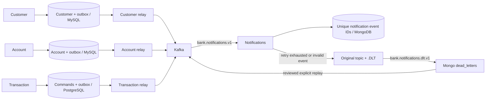

# Phase 5 — Kafka events, transactional outbox and notifications

Customer, Account and Transaction services now own an event outbox in their respective databases. Notification Service consumes versioned JSON events from Kafka and stores notifications in MongoDB. It never changes balances or posts transactions. Phase 4 remains the monetary authority.



## What emits an event

| Producer | Business commit | Event type | Topic |
|---|---|---|---|
| Customer | New customer | CUSTOMER_CREATED | `bank.customer.created` |
| Account | New account | ACCOUNT_CREATED | `bank.account.created` |
| Transaction | Terminal successful monetary request | TRANSACTION_COMPLETED | `bank.transaction.completed` |
| Transaction | Terminal business rejection | TRANSACTION_FAILED | `bank.transaction.failed` |
| Future Fraud Detection | Future rule detection | SUSPICIOUS_TRANSACTION_DETECTED | `bank.fraud.detected` |

Transaction events include `operationType`, so consumers distinguish transfer completion/failure from deposits/withdrawals. PENDING or unconfirmed postings emit no terminal outcome event. An existing idempotency key, repeated posting receipt, account status change or customer deactivation does not emit another creation/outcome event. The Fraud consumer and topic are implemented and tested with synthetic events; the advanced fraud detector is not implemented. Existing records predating these migrations are not backfilled into Kafka.

## Atomic local capture, asynchronous delivery

Customer V2, Account V3 and Transaction V2 introduce local `event_outbox` tables. Earlier applied migrations are unchanged. Event ID is the primary key, `(event_type,aggregate_id)` is unique, and rows retain type, aggregate, topic, serialized immutable JSON, status, attempts, next-attempt time and publication time. Transaction V2 also adds a persistent UUID `correlation_id` to requests, including existing rows with generated defaults.

`EventOutbox.add` uses `@Transactional(propagation=MANDATORY)`: it must join an existing local transaction and cannot silently create an independent event commit. Customer/account creation and outbox insertion succeed or roll back together. Transaction outcome and its event commit in the same PostgreSQL transaction. If that capture fails after Account already posted money, PostgreSQL remains PENDING; Phase 4's stable posting ID safely reconciles it on retry. No Kafka connection is required to commit a business change.

Each service has its own outbox implementation and SQL access. Only `common-contracts/.../events/v1` wire DTOs are shared; no entities or repositories cross service boundaries.

The scheduled relay polls every 500 ms in bounded batches, locks one due row using `FOR UPDATE SKIP LOCKED`, sends its aggregate ID as the Kafka key, waits for broker acknowledgement, then marks PUBLISHED. READ COMMITTED reduces MySQL gap locking. The outbox row lock spans the bounded broker call; the relay never locks a balance/account/customer business row. Kafka uses string JSON, `acks=all`, idempotent producers and bounded metadata/delivery timeouts. Broker failures retain PENDING with persisted backoff (1, 2, 4, …, capped at 60 seconds); there is no automatic event discard or retry limit.

There is no atomic commit spanning a relational database and Kafka. If the broker accepted the event but the relay crashes or its database mark fails, the row stays pending and the same event ID/JSON can be published again. Kafka producer idempotence suppresses some producer-session duplicates, **not** this entire database/Kafka gap. The consumer's unique event ID closes the duplicate-side-effect gap for MongoDB notification records. This is at-least-once delivery, not exactly-once transport.

Published payloads remain retained in the outbox; no automatic destructive cleanup is introduced. Operators must monitor pending age, attempts, consumer lag and DLT backlog before choosing a retention/archival policy.

## JSON schema, versions and correlation

The [v1 JSON schema](events/bank-event-v1.schema.json) describes the envelope; Java contract validation additionally checks identifiers, producer/type correspondence, aggregate references and monetary precision.

```json
{
  "eventId": "11111111-1111-4111-8111-111111111111",
  "eventType": "CUSTOMER_CREATED",
  "version": 1,
  "correlationId": "22222222-2222-4222-8222-222222222222",
  "producer": "customer-service",
  "occurredAt": "2026-10-09T12:00:00Z",
  "aggregateId": "42",
  "data": {"customerId": "42"}
}
```

Payload values are strings: monetary values use decimal text, avoiding floating-point event calculations. Producers omit customer names, email and phone. Account events contain account/customer IDs, type and currency. Outcome events include request UUID, operation type, account references, amount/currency and failure code where applicable. Customer/account data is not fetched again by the consumer.

The event UUID and JSON are assigned once during local capture and reused on every relay retry. `X-Correlation-ID` is accepted as a canonical UUID by the three business services, echoed in responses or generated if absent; invalid headers return 400 before business processing. It is forwarded on customer/account REST lookups. Transaction requests persist the original correlation ID, workers forward it to Account's posting endpoint, and delayed outcome events preserve it. Notification logs include event ID/type/correlation ID rather than contact data or full payloads. This is correlation propagation, not full tracing/structured observability (Phase 7).

The consumer deserializes strings explicitly into `BankEventV1`, validates schema version 1, producer/type, topic, required data and aggregate references. It does not instantiate arbitrary classes from untrusted Java type headers. Unknown versions and malformed/mismatched events are quarantined. Future incompatible versions require a new contract and deliberate consumer migration.

## Kafka concepts in this application

* **Broker:** the Kafka server storing topic logs. Local Compose runs one KRaft broker/controller with a persistent volume; no ZooKeeper. This is development infrastructure, not high availability.
* **Topic:** an append-only event stream, e.g. customer creations. Five original topics and five corresponding `.DLT` topics are provisioned by Notification's KafkaAdmin. Automatic broker topic creation is disabled in Compose; early producer sends retry until provisioning completes.
* **Partition:** a topic's independent ordered log. Each topic has three partitions. The aggregate ID key chooses a partition consistently for that key while the partition count remains unchanged. There is no global order across partitions/topics, and no cross-account ordering guarantee for transaction events keyed by transaction UUID. Notification correctness does not depend on arrival order.
* **Offset:** the position of a record within one partition. Committed offsets indicate the next record to consume, not a global sequence or proof of money movement. Notification API metadata exposes original topic, partition and offset.
* **Consumer group:** independent subscribers sharing partitions. `bank.notifications.v1` has three concurrent consumer threads; each partition is assigned to at most one member of that group. A second group can read the same records independently. `bank.notifications.dlt.v1` independently retains dead letters.
* **Rebalance:** when group members start/stop, partition ownership moves. A crash or rebalance can redeliver a record whose Mongo write succeeded before offset commit. The event-ID upsert remains safe. Groups must keep stable names on restart; changing a group creates a new subscription, not a reset of the old one.

Auto-commit is disabled. RECORD acknowledgement and synchronous offset commits occur only after the Mongo handler returns successfully or the error handler has successfully published the record to DLT. Producer and consumer schemas are explicit; the consumer starts at earliest only when no committed group offset exists.

Original topics retain seven days; DLT topics thirty days, using delete retention. A consumer must recover before retention expires or use a reviewed replay from retained outbox payloads. The one-broker replication factor is one: volume loss is not tolerated by Kafka alone. Production needs replication, broker/database backups and operational monitoring; notifications are not the authoritative ledger.

## Duplicate-safe storage, retries and DLT

Mongo `notifications._id` is the event UUID. An atomic `$setOnInsert` upsert with majority/journal acknowledgement stores the entire canonical envelope plus Kafka metadata once. Concurrent duplicate-key races read/verify the existing record. Identical duplicates return without a second notification; conflicting payloads using the same event ID go to DLT rather than overwriting the original. This guarantee covers stored records, not external email/SMS delivery (not connected).

Transient storage errors retry the original partition using blocking `DefaultErrorHandler` backoff: first delivery plus two retries, 500 ms between retries. Blocking retry may delay other partitions assigned to that thread. Exhaustion publishes the original raw record to `<originalTopic>.DLT`, preserving the original partition and Kafka DLT metadata. Malformed schema, unknown version, wrong topic or ID-content conflict goes directly to DLT without transient retries.

DLT publishing waits for acknowledgement and fails recovery if the send is unconfirmed; the source offset must not advance by treating a failed recovery as success. A separate DLT listener stores raw payload/key/original topic and DLT coordinates in Mongo `dead_letters`, with a deterministic coordinate-derived ID. It retries indefinitely if Mongo is unavailable and never creates a DLT-of-DLT loop. Kafka retains the quarantined record while its Mongo view is unavailable.

Manual replay keeps the quarantine record. POST `/api/notifications/dead-letters/{id}/replay` validates the original event, republishes it and returns 202 REPLAY_REQUESTED. A valid event that failed during a Mongo outage can be replayed unchanged; malformed data returns 422 until an optional `{ "correctedPayload": "<valid JSON string>" }` is supplied. Kafka publication and replay metadata updates are not atomic; if the HTTP response is ambiguous, retry with the same event ID/payload, letting notification deduplication protect the result. A replay is not itself proof of completed delivery; query the returned event ID. Corrected IDs/content require deliberate review, and cannot overwrite an already stored event. No automatic replay loop is enabled.

## API and files

| Method | Gateway path | Meaning |
|---|---|---|
| GET | `/api/notifications` | Paginated records; optional eventType, aggregateId and UUID correlationId |
| GET | `/api/notifications/{eventId}` | Stored envelope and Kafka metadata; 404 when absent |
| GET | `/api/notifications/dead-letters` | Paginated retained quarantine records |
| POST | `/api/notifications/dead-letters/{id}/replay` | Reviewed development replay; 202, 404, 422 or unconfirmed broker 503 |

Pages use `{items,page,size,totalElements,totalPages}`, page 0–10000, size 1–100, sorted by receipt time and ID. Mongo pagination is not a cross-request snapshot. Storage failures return 503 with no credential/server detail. Notification OpenAPI and Swagger are direct on 8085. Gateway strips `/api` and preserves `/notifications`; foundation probes remain compatible. Authentication/roles/ownership for reads and administrative replay belong to Phase 6; all current flows use local development data.

Files: versioned event records/schema; service-owned migration, EventOutbox, OutboxRelay, OutboxJob and CorrelationFilter; existing creation/outcome services and REST clients; Notification Kafka configuration, codec/consumer, Mongo stores, API/advice; Compose dual Kafka listeners/Mongo port; gateway/host startup; event smoke and Postman collection. Tests use real disposable MySQL, PostgreSQL, Kafka and MongoDB, with narrow SQL failures and controlled consumer failure injection.

## Start, test and inspect

```bash
source scripts/cloud-environment.sh  # cloud only
./gradlew --no-daemon build
# Generate ignored .env once only if absent: python3 scripts/create-local-env.py
docker compose config --quiet
docker compose build customer-service account-service transaction-service notification-service
docker compose up -d --wait --wait-timeout 300 api-gateway transaction-service notification-service
docker compose restart api-gateway  # existing gateway: load new Notification route
python3 scripts/events-smoke-test.py
# Phase 4 monetary regression remains useful:
python3 scripts/transaction-smoke-test.py
# Optional Postman runner:
npx --yes newman@6.2.1 run postman/events.postman_collection.json --delay-request 200
```

This starts twelve containers, excluding Auth, Keycloak and optional monitoring. Applications use `KAFKA_BOOTSTRAP_SERVERS=kafka:9092` inside Compose and `localhost:19092` for host Java. Kafka advertises distinct internal/host listeners. Notification Mongo defaults to loopback port 27018, database notifications, with bounded connect/server-selection/socket/write timeouts; containers use notification-db:27017. No notification Mongo credential is hardcoded. Secure Mongo/broker identities are later work.

Host alternative: stop project application containers first, then `bash scripts/start-local.sh` and the same event smoke. Host startup now starts both MySQL stores, Transaction PostgreSQL, Mongo and Kafka unless explicit external endpoint overrides are set. Stop owned Java with `bash scripts/stop-local.sh` and stores/broker with `docker compose stop customer-db account-db transaction-db notification-db kafka`. Do not run host/container applications on the same ports. Stop/remove Compose containers with `docker compose down`, preserving volumes.

```bash
# Narrow automated check:
./gradlew :common-contracts:test :customer-service:test :account-service:test :transaction-service:test :notification-service:test
# Topics / partitions / retention:
docker compose exec -T kafka /opt/kafka/bin/kafka-topics.sh --bootstrap-server localhost:9092 --describe
# Group offsets and lag:
docker compose exec -T kafka /opt/kafka/bin/kafka-consumer-groups.sh --bootstrap-server localhost:9092 --group bank.notifications.v1 --describe
curl 'http://localhost:8080/api/notifications?eventType=TRANSACTION_COMPLETED&size=20'
curl 'http://localhost:8080/api/notifications/dead-letters?size=20'
```

Use a real development event ID/correlation when querying. The smoke verifies all three outboxes, eight unique correlated notifications including transfer success/failure, and drains/closes its synthetic accounts while retaining audit data. Restart/outage checks must preserve volumes and stable group names. Executed results are recorded in [Phase 5 verification](phase-5-verification.md).

Phase 6 adds Keycloak/OIDC resource-server validation, roles, resource ownership and authenticated internal APIs. This phase does not send email, implement fraud detection, change monetary orchestration, or claim production Kafka availability/security.
