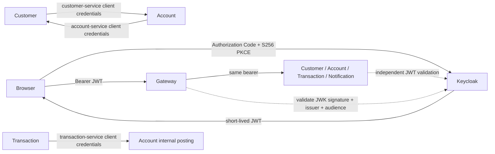

# Phase 6 — Keycloak, JWTs and resource ownership

Gateway and Auth/Customer/Account/Transaction/Notification services now validate bearer JWTs independently. Spring Security OAuth2 Resource Server verifies RS256 signatures from Keycloak JWKs, trusted issuer, `banking-api` audience, token timestamps and a nonempty bounded subject. There is no security-off property or custom JWT cryptography. Direct backend access has the same authorization requirements as gateway traffic.



## Login and trusted identity

The public `banking-local` client uses Authorization Code with mandatory S256 PKCE, exact local callback `http://localhost:8080/callback`, and no implicit flow, password grant, service account or client secret. A browser/client obtains login tokens directly from Keycloak; the application does not accept or store login passwords. `GET /api/auth/oidc` returns public flow metadata. `GET /api/auth/me` returns verified subject/roles and an optional customer ID. There is no frontend callback UI in this repository; clients must handle the registered callback, verify state, and exchange the code with the verifier. The development helper simulates that client, including state verification.

Keycloak owns password hashing and sessions. Access tokens last five minutes; session idle time is thirty minutes and maximum session life eight hours. Refresh uses the IdP token endpoint; logout uses its end-session endpoint. JWT access tokens remain usable until expiry after logout; immediate revocation, MFA and production session policy are not claimed. Clients must store tokens securely and avoid logging them. Stateless APIs disable CSRF because authorization uses explicit bearer headers and no login/session cookies; adding a cookie-based application would require a new CSRF design.

`customer_id` is a string-valued claim derived from an **admin-only** Keycloak user attribute, through the bank client scope. It links an IdP subject to a database customer ID. There is no email-based inference, request header, request-body ID or self-service endpoint that can grant ownership. An unlinked CUSTOMER gets 403. Administrators must verify the identity before assigning/changing this binding. Historical customers are deliberately unlinked until provisioned. The local smoke binds tagged fixture users through the privileged IdP admin API; business staff credentials cannot manage the realm. The user profile disallows unmanaged attributes and exposes customer_id/banking_fixture only to realm administrators.

## Authorization matrix

| Operation | Allowed identity |
|---|---|
| Customer create/list/deactivate | ADMIN or BANK_EMPLOYEE |
| Customer get/update/account overview | Staff, or CUSTOMER with matching trusted customer_id |
| Account create/status change | Staff |
| Account get/balance/by-customer | Staff, or owning CUSTOMER |
| Deposit | Staff (development funding; real settlement remains future work) |
| Withdrawal | Staff, or owning CUSTOMER |
| Transfer | Staff, or CUSTOMER owning source account; recipient ownership is not required |
| Transaction get | Staff, or CUSTOMER owning at least one involved account |
| Account transaction history | Staff, or owning CUSTOMER |
| Global transaction search | Staff |
| Notification reads, quarantine and replay | ADMIN |
| Account ledger reconciliation | ADMIN, directly on the backend |
| Internal Customer status | account-service identity only |
| Internal Account overview | customer-service identity only |
| Internal Account posting | transaction-service identity only; even human ADMIN is denied |

Owned account/customer IDs are immutable in this API. Transaction ownership verification forwards the current user bearer only to the configured Account Service, whose own guard validates that user. Dependency failure returns 503, never an ownership grant. The worker does not store or reuse user access tokens: accepted requests remain durable after a user token expires, and workers authenticate as Transaction Service. A transfer exposes its record to either participant, including counterpart references and amount; it does not grant access to the counterpart's customer/account record.

The gateway validates JWTs and applies coarse bank-role/admin rules before routing. Backend method security enforces ownership and the finer matrix before writes. Public internal routes do not exist at the gateway. Unknown API/controller paths grant no additional access. Only health/foundation probes and public OIDC metadata are anonymous; other Actuator endpoints are admin-only and Swagger/OpenAPI are staff-only. Foundation probes expose service identity, not customer data.

Realm human roles are accepted only for `azp=banking-local`. Service roles are accepted only for the corresponding known authorized party. A role string copied into a token from the wrong client does not grant a service privilege. Three confidential clients have only their respective SERVICE_CUSTOMER/SERVICE_ACCOUNT/SERVICE_TRANSACTION realm role. Client credentials are generated locally, injected privately and exchanged server-side; bounded tokens are cached and renewed before expiry. IdP errors expose no credentials or response body. Passwords/tokens are absent from business databases and events.

Internal endpoints are intentionally narrow: Customer returns only ID/status at `/internal/v1/customers/{id}/status`; Account returns one customer's paginated overview at `/internal/v1/accounts/customer/{id}`; posting remains `/internal/v1/postings`. Service tokens are denied public customer/account business reads and public gateway bank-role routes.

## Idempotency upgrade safety

Transaction V3 adds nullable `request_subject`, retaining NULL for historical requests. New HTTP commands hash issuer + subject + caller key into a `P6-` key namespace and retain the subject. Refresh/re-login of the same identity preserves its namespace; different identities can safely use the same raw key. Existing atomic Account receipts and durable retry IDs remain unchanged.

A raw key already present on a legacy unbound request returns **409**. The application cannot infer that historical initiator, so it does not silently apply the request again under a new caller namespace or automatically assign it to a user. Staff must inspect the original transaction and monetary receipt before issuing a new operation. Applied migrations and financial/audit records are retained.

## Local development startup

```bash
source scripts/cloud-environment.sh  # cloud only; activates Java/Docker/Gradle/npm
# Generate .env only if missing: python3 scripts/create-local-env.py
python3 scripts/prepare-security-env.py  # adds missing entries, preserves existing credentials
./gradlew --no-daemon build
docker compose config --quiet
docker compose up -d --wait --wait-timeout 240 keycloak
python3 scripts/setup-keycloak.py
docker compose build api-gateway auth-service customer-service account-service transaction-service notification-service
docker compose up -d --wait --wait-timeout 300 api-gateway auth-service transaction-service notification-service
docker compose restart api-gateway
python3 scripts/security-smoke-test.py
python3 scripts/events-smoke-test.py
python3 scripts/transaction-smoke-test.py
python3 scripts/run-authenticated-postman.py postman/events.postman_collection.json
python3 scripts/run-authenticated-postman.py postman/security.postman_collection.json
```

This fourteen-container target adds Keycloak and Auth to Phase 5. Bootstrap/import is not a migration for an existing realm, so setup-keycloak.py reconciles the repository's development settings on retained volumes. It creates/reuses five tagged phase6-* fixture users and refreshes their generated passwords/roles, preserving their customer bindings; it refuses to overwrite untagged users. It creates the bank scope if missing, provisions clients and their generated secrets/least-privilege roles, and secures user-profile attributes. It is a local-development provisioning command, not production identity management. Never point it at a production IdP.

Ignored `.env` contains random local development credentials with file mode 0600; source files contain no credentials. The prepare script only adds missing entries. Existing exported values override local files. For manual login, use phase6-admin/employee/alice/bob/roleless and retrieve the corresponding BANK_*_PASSWORD securely from your local secret configuration, not chat or logs. Alice/Bob need a trusted customer binding; the security smoke establishes bindings only for its synthetic records. Their resulting customer records are deactivated after the smoke.

The issuer is consistently `http://localhost:8090/realms/banking` for host and container tokens. Containers fetch JWKs and service tokens at `http://keycloak:8080`; validation still requires the canonical issuer. Separate `KEYCLOAK_ISSUER`, `KEYCLOAK_JWK_SET_URI`, `KEYCLOAK_TOKEN_URI` and per-service `SERVICE_CLIENT_SECRET` settings support external deployment. Do not derive trusted issuers/JWK endpoints from tokens or caller headers. Host startup uses the corresponding CUSTOMER_SERVICE_CLIENT_SECRET, ACCOUNT_SERVICE_CLIENT_SECRET and TRANSACTION_SERVICE_CLIENT_SECRET settings.

The checked-in realm is for loopback development: start-dev, local HTTP callback/issuer, sslRequired=none and file-backed Keycloak development storage. Keycloak's localhost Secure-cookie behavior is adapted only in the test helper for the exact same loopback origin; this does not disable TLS verification. Production needs HTTPS at the IdP/APIs, exact production redirects, realm SSL enforcement, hardened Keycloak storage, broker/database identities, managed secrets/rotation, backups and restricted infrastructure networks. Local Docker web/database ports are loopback-only. The implementation verifies application JWTs/ownership; it is not a production deployment or a security audit.

Host Java alternative: stop Compose application containers, then `bash scripts/start-local.sh`. It starts/configures local Keycloak unless an external KEYCLOAK_ISSUER is supplied, starts five event/database infrastructure containers, injects per-service secrets and runs the eight-app foundation smoke. Run the same security/event checks; stop owned Java with `bash scripts/stop-local.sh`. Never mix host and container applications on the same ports.

Existing write smoke scripts authenticate through real local PKCE automatically, renew their admin token privately, or accept an externally supplied BANK_ACCESS_TOKEN. Postman collections inherit `{{accessToken}}` bearer authorization. The runner creates a private temporary environment, deletes it afterward, and retains only token-free aggregate statistics because Newman's full report contains Authorization headers. Never commit or share exported bearer environments/reports.

## Implementation and verification

`security-support` is a separate Spring Security library, not the wire-contract module. It shares JWT validation/role parsing, access helpers and service-token exchange; it contains no service entities/repositories. Servlet resource services use its auto-configuration and their own guards. The reactive gateway has its own WebFlux chain. Test fixtures are a separate Gradle test-fixtures artifact and are never included in application jars; production has no fixture decoder or security-off switch.

Tests use actual RSA-signed JWTs and a local JWK endpoint to check missing/invalid signatures, issuer/audience/expiry/not-before, key rotation, owned claims and service authorized-party rules. Real-database API tests ensure denied reads/writes and internal calls cannot mutate business data. Existing monetary/outbox/Kafka tests remain enabled and authenticated. The deployed smoke additionally checks real Keycloak PKCE/refresh and independent gateway/backend guards. See [executed results](phase-6-verification.md).

Phase 7 is observability. MFA, production IdP/network hardening, external payment settlement, email/SMS and advanced fraud detection are outside this phase.
