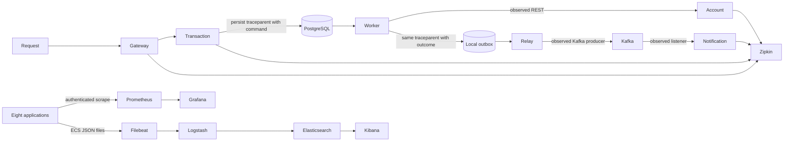

# Phase 7 — metrics, distributed traces and centralized JSON logs

Eight applications now export Prometheus metrics, propagate W3C trace context and emit Spring Boot ECS JSON logs. Grafana provisions a service overview; Zipkin receives sampled spans; Filebeat sends structured application files through Logstash into Elasticsearch for Kibana. All financial stores, posting rules, JWT roles and customer ownership remain authoritative in their original services.



## Metrics and authentication

Micrometer's Prometheus registry exports HTTP request counts/latency histograms, JVM memory, process and connection-pool metrics. A bounded `application` label identifies a service. Each Customer/Account/Transaction producer also registers `bank_outbox_pending` and `bank_outbox_oldest_seconds` gauges. A five-second scheduled query samples pending rows without running database SQL on every scrape. Database sampling failure sets -1 and has its own alert. Request/customer/account/event IDs, emails, keys and amounts are never metric labels.

`observability-support` shares instrumentation primitives and a servlet metrics-only Spring Security chain; it shares no entities or repositories. The reactive gateway has an equivalent chain. `/actuator/prometheus` requires the dedicated monitoring Basic credential, with a MONITORING authority that grants no banking privilege. Missing configuration leaves scraping inaccessible. Other backend APIs retain Phase 6 bearer authentication/ownership; health and foundation probes remain anonymous. Config/Discovery keep their existing development infrastructure access, with their metrics authenticated.

Prometheus scrapes eight Docker service names every fifteen seconds using a password file generated into ignored local configuration. The password is not in YAML/Git. Four alert rules cover scrape failure, delayed outboxes, server errors and failed backlog collection. Rules are evaluated locally; no Alertmanager delivery integration is configured. Grafana provisions Prometheus and Zipkin data sources plus six panels: availability, request rate, p95 latency, pending/oldest events and JVM heap. Graphs depend on real requests and observation windows; empty recent-rate graphs during startup are expected.

## Tracing through asynchronous money and events

Spring Boot auto-configures Micrometer Tracing with OpenTelemetry and Zipkin export. Existing injected `RestClient.Builder` instances retain their observation instrumentation. W3C propagation and automatic Reactor context propagation cover reactive/servlet boundaries. Kafka templates and the explicitly configured listener containers enable observations.

A request's HTTP span cannot remain on a thread after returning 202. Transaction V4 adding nullable traceparent columns to commands and outbox rows. Customer V3 and Account V4 add traceparent to their outboxes. No existing migration is edited and no financial data is reset. Only traceparent is persisted: no bearer token, body, contact data or custom identity field.

`DurableTrace.capture` injects the current context through Micrometer's propagator; `resume` extracts it and opens a scoped `transaction.process` or `outbox.publish` span. The worker resumes the stored request context before calling Account, so the posting client/server and terminal outbox continue the same trace. The relay resumes the captured event context before Kafka send, and the Notification listener continues the producer's observed context. Retries retain the original trace context and generate new attempt spans. Legacy rows with no context remain processable and start a new trace.

Spans/scopes close in all return/error paths; correlation MDC is restored. The worker's span covers processing, not a guarantee that the final PostgreSQL commit succeeded. A logged posting receipt can precede a failed local terminal commit; Phase 4 retry/idempotency still determines the monetary result. Telemetry is observational and never compensates, rejects or commits a financial operation.

Default sampling is 10%; `TRACING_SAMPLE_RATE=1` can enable full local sampling. The smoke supplies a valid sampled W3C context for one synthetic workflow. Sampling can omit production events from Zipkin; missing telemetry is not evidence that money did not move. Zipkin's local in-memory store is bounded to 10,000 spans and is cleared on restart. It is not an authoritative or durable financial audit.

To follow a transfer: retain its transaction UUID, correlation ID and sampled trace ID; find `transaction.process` in Zipkin, follow the Account REST posting and outbox/Kafka/Notification spans, then search Elasticsearch/Kibana for the same traceId or correlationId/transaction ID. Confirm the durable transaction and immutable posting receipt independently when investigating an ambiguous operation.

## Logging and retention

Boot ECS formatting writes console and rolling file JSON, including service name, timestamp, level, message, traceId/spanId and available correlation MDC. Sanitized worker, posting and notification messages contain operation/event identifiers and status; they omit money amounts, contact values and authentication material. Filebeat reads only a named application log volume, never the Docker socket. Its registry persists independently, so restart resumes file positions. Logs may duplicate and are not notification/ledger records. The collector tails active files; an outage spanning compressed rotation can leave archives unshipped and require reviewed recovery. This is not a lossless audit pipeline.

Logstash parses forwarded JSON, drops credential fields and redacts email/JWT patterns in messages before indexing daily `bank-logs-*` indices. This is defense in depth, not permission to log payloads or credentials. Debug HTTP/header logging must remain off. `setup-log-retention.py` creates a seven-day ILM policy/template for new log indices; existing indices are not deleted by setup. Application rolling files and Prometheus disk retention are bounded; monitor disk capacity before expanding workloads.

The ELK stack is development-only: security-disabled single-node Elasticsearch, loopback-published Elasticsearch/Kibana, internal Beats ports. Prometheus/Grafana/Zipkin are also loopback-published; Grafana uses a generated local admin password and disables signup. Production needs HTTPS, authenticated telemetry access, restricted networks, managed secrets, durable trace storage and capacity/retention policies. Telemetry exposes operational metadata, so do not publish these local ports to the internet.

## Start and verify

```bash
source scripts/cloud-environment.sh  # cloud only
# Generate .env only if missing: python3 scripts/create-local-env.py
python3 scripts/prepare-security-env.py
python3 scripts/prepare-monitoring.py
./gradlew --no-daemon build
docker compose up -d --wait --wait-timeout 240 keycloak
python3 scripts/setup-keycloak.py
docker compose build discovery-server config-server api-gateway auth-service customer-service account-service transaction-service notification-service
docker compose up -d --wait --wait-timeout 300 api-gateway auth-service transaction-service notification-service
bash scripts/start-monitoring.sh
# Once Elasticsearch is ready:
python3 scripts/setup-log-retention.py
python3 scripts/monitoring-smoke-test.py
python3 scripts/security-smoke-test.py
python3 scripts/events-smoke-test.py
python3 scripts/transaction-smoke-test.py
```

The standard monitoring profile adds seven containers to the fourteen-container secured target. On this VFS cloud machine, the startup helper leaves Kibana stopped and runs the twenty-container core telemetry target. Kibana is tested/used in a separate viewing mode after temporarily removing Grafana and Zipkin containers, retaining Grafana and Elasticsearch data. Zipkin memory is transient. Startup does not make monitoring availability a prerequisite of committing banking operations. Metrics scrape failures, tracing-export failures or missing log collectors must be investigated separately from business results. Stop monitoring containers without removing data volumes when resources are needed for tests.

The cloud uses Docker VFS on a 32 GB disk. Layered ELK images exceed its peak registration space. `prepare-vfs-monitoring.py` uses the checksum-verified official crane tool to export digest-pinned vendor filesystems and import single-layer local copies, preserving command, entrypoint, environment, user, workdir and exposed ports. The ignored override selects these local images; source digests are retained in `.run/monitoring/image-provenance.json`. The checked-in Compose still uses official images on ordinary Docker. This changes storage layout, not application files or TLS/digest verification. All seven monitoring images are flattened on VFS; unused duplicate vendor tags may be removed without forcing deletion of images used by running containers. Cloud crane is retained at `/workspace/toolchains/bin/crane`; normal overlay-based Docker does not need this workaround.

For host Java, the existing start script prepares monitoring credentials, and applications log to ignored `.run/logs/`. Docker Filebeat reads the Docker named volume; collecting host files requires a deliberate Filebeat bind override. The documented full ELK verification uses container applications, not an implicit host-file collector.

There is no new banking schema beyond nullable instrumentation metadata. Tests prove durable parent continuation after scope closure, legacy no-context behavior, scrape credential rejection/acceptance and existing security/financial/event invariants. The live smoke requires all eight scrape targets, dashboard/source provisioning, one trace across gateway/worker/Account/Kafka/Notification and indexed transfer logs from three services, then drains/closes synthetic accounts. See [executed verification](phase-7-verification.md).

Phase 8 is deployment/CI/CD and Kubernetes. Alert delivery, production telemetry hardening and advanced banking features are future work.

## Kibana viewing mode on the constrained cloud

```bash
# Preserve Grafana data; Zipkin spans are intentionally in memory.
docker compose -f docker-compose.yml -f .run/monitoring/vfs.compose.json --profile monitoring stop grafana zipkin
docker compose -f docker-compose.yml -f .run/monitoring/vfs.compose.json --profile monitoring rm -f grafana zipkin
docker compose -f docker-compose.yml -f .run/monitoring/vfs.compose.json --profile monitoring up -d --no-deps kibana
python3 scripts/setup-log-retention.py --kibana
# Return to the core Grafana/Zipkin view:
docker compose -f docker-compose.yml -f .run/monitoring/vfs.compose.json --profile monitoring stop kibana
docker compose -f docker-compose.yml -f .run/monitoring/vfs.compose.json --profile monitoring rm -f kibana
bash scripts/start-monitoring.sh
```

Elasticsearch uses absolute development disk watermarks (1 GB / 768 MB / 512 MB), appropriate for this shared 32 GB filesystem. Production should select capacity-based thresholds deliberately. The initial full profile reached the default flood watermark; writes were restored after freeing space and clearing the development index block. No financial data or indices were erased. Monitoring is paused/removed before large Testcontainers runs, preserving volumes.
